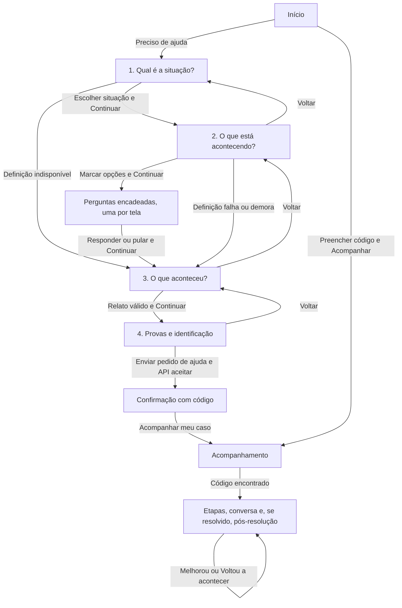
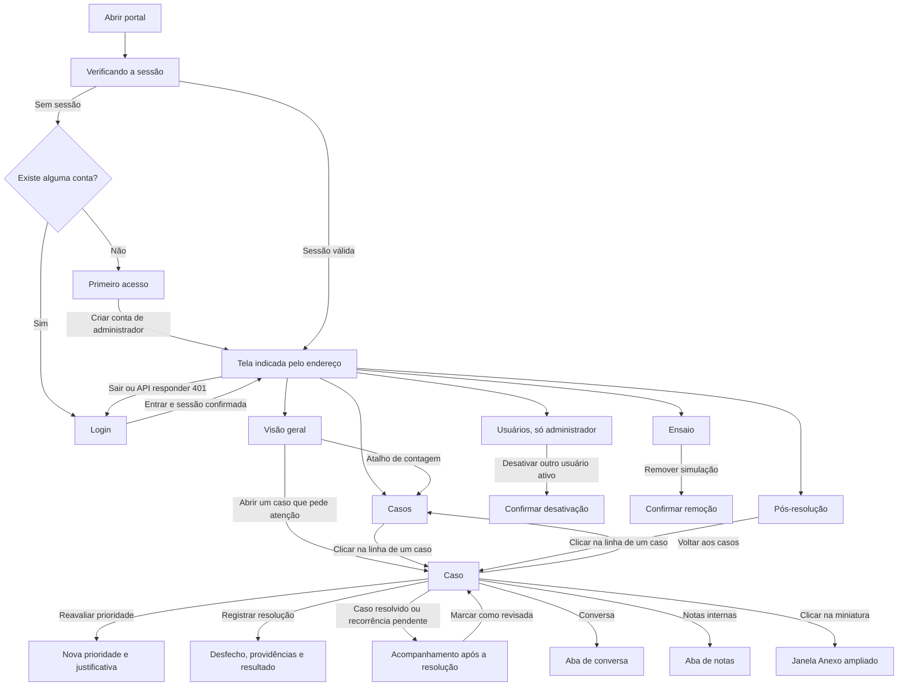

# Mapa e índice das interfaces

As definições atuais estão em [docs/DEFINICOES.md](docs/DEFINICOES.md). A seção da coordenação descreve o portal da v2 (3 status, 4 prioridades, resolução e pós-resolução); a do aluno descreve o pedido de ajuda em quatro passos, o acompanhamento em três estados e a área pós-resolução.

Prévias aprovadas: [aluno jovem e expressivo](http://127.0.0.1:5173/aluno-revisao.html) e [coordenação acolhedora](http://127.0.0.1:5173/revisao.html). O índice da base original permanece em [interfaces.html](http://127.0.0.1:5173/interfaces.html).

Mapeamento do frontend copiado, baseado nos componentes e seus gatilhos de navegação. Inclui telas, etapas, abas, janelas e estados condicionais.

## Entradas

| Portal | Endereço local | Entrada no código |
| --- | --- | --- |
| Aluno | [Abrir aluno](http://127.0.0.1:5173/) | `index.html` → `src/aluno/main.tsx` → `src/aluno/App.tsx` |
| Coordenação | [Abrir coordenação](http://127.0.0.1:5173/coordenacao.html) | `coordenacao.html` → `src/coord/main.tsx` → `src/coord/App.tsx` |

Os links exigem o servidor local ativo. As transições que exigem resposta da API dependem do backend (`python backend/entrada.py`).

## Fluxo do aluno

| ID | Interface | Gatilho para chegar | Condição | Componente |
| --- | --- | --- | --- | --- |
| A01 | Início: “Você não precisa lidar com isso sozinho.” | Abrir o portal ou clicar em **Voltar ao início** | Não exige API; traz o bilhete, o campo de código e o aviso “Antes de contar” | `src/aluno/Inicio.tsx` |
| A02 | Passo 1: “Qual é a situação?” | A01 → **Preciso de ajuda** | Seis situações mais Outros; escolha obrigatória | `src/aluno/Denuncia.tsx` |
| A03 | Passo 2: “O que está acontecendo?” (opções) | A02 → situação → **Continuar** | Opções vindas de `GET /api/questionario`; pelo menos uma opção. Se a definição falhar, o passo é pulado com aviso; se demorar, aparece “Carregando as perguntas…” e **Continuar só com o relato** (saída automática em 8 s) | `src/aluno/Denuncia.tsx` |
| A03a | Passo 2: perguntas encadeadas | A03 → **Continuar** | Uma pergunta por tela, com “Pergunta N de M” e foco na pergunta; nenhuma é obrigatória; responder pode abrir outras perguntas e mudar a resposta fecha as dependentes | `src/aluno/Denuncia.tsx`, `src/aluno/fluxo.ts` |
| A03b | Orientação de risco | A03a → “Você está seguro agora?” com “Não” ou “Quero falar com alguém hoje” | Aviso de apoio imediato na tela e de novo na confirmação; não bloqueia o fluxo | `src/aluno/Denuncia.tsx`, `src/aluno/Confirmacao.tsx` |
| A04 | Passo 3: “O que aconteceu?” | A03 → **Continuar** | Texto próprio de pelo menos 10 caracteres; o relato vai só com o texto do aluno e tem até 5000; o contador mostra o excesso | `src/aluno/Denuncia.tsx` |
| A05 | Passo 4: “Provas e identificação” | A04 → **Continuar** | Imagens opcionais; anônimo por padrão | `src/aluno/Denuncia.tsx` |
| A05a | Campos “Seu nome” e “Sua turma” | A05 → **Quero me identificar** | Nome obrigatório; turma opcional | `src/aluno/Denuncia.tsx` |
| A05b | Prévias de imagens, com **Girar** e **Remover** | A05 → **Adicionar imagens** | Até 5 imagens de até 5 MB; PNG, JPEG, WebP ou GIF; GIF não gira | `src/aluno/Denuncia.tsx`, `src/aluno/girarImagem.ts` |
| A06 | Confirmação: “Você deu o primeiro passo.” | A05 → **Enviar pedido de ajuda** | Sucesso de `POST /api/denuncias`; mostra o código uma única vez | `src/aluno/Confirmacao.tsx` |
| A07 | Acompanhamento | A01 → código → **Acompanhar**, ou A06 → **Acompanhar meu caso** | Sucesso de `POST /api/acompanhar` | `src/aluno/Acompanhar.tsx` |
| A07a | Linha do tempo de três etapas | A07 | Recebido, Em investigação, Resolvido; cada etapa diz “Concluída”, “Etapa atual” ou “Próxima” | `src/aluno/Acompanhar.tsx` |
| A07b | Conversa com a coordenação | A07 | Mensagens do caso e campo de resposta | `src/aluno/Acompanhar.tsx` |
| A08 | “Seu caso foi resolvido” | A07 com `pos_resolucao` verdadeiro e resolução presente | Mostra desfecho, providências e resultado como texto; pergunta “Como você está agora?” | `src/aluno/PosResolucao.tsx` |

### Retornos e ações internas do aluno

| Onde | Gatilho | Resultado |
| --- | --- | --- |
| Qualquer tela fora do início | **Voltar ao início** | Volta a A01; desabilitado durante o envio do pedido |
| Passos 2, 3 e 4 | **Voltar** | Retrocede uma etapa ou uma pergunta e mantém os campos; do relato volta à última pergunta vista; sem detalhes volta ao passo 1 |
| Formulário com rascunho | **Limpar rascunho** | Apaga o rascunho e volta ao passo 1; não remove imagens já anexadas |
| Passo 1 | Trocar de situação | Descarta as opções marcadas e as respostas da situação anterior |
| Perguntas | Mudar ou desmarcar uma resposta | Fecha as perguntas que dependiam dela e apaga as respostas delas |
| Passo 2 (definição indisponível) | Aviso “Não foi possível carregar as perguntas agora” | O pedido segue só com situação e relato |
| Confirmação | 400 `respostas invalidas` no envio | Reenvia uma vez sem `respostas`; a confirmação avisa que as respostas não foram enviadas |
| Passo 4 | **Quero ficar anônimo** | Oculta e limpa nome e turma |
| Prévia de anexo | **Girar** | Gira 90 graus; se falhar ou passar de 5 MB, a original continua anexada; o envio fica bloqueado enquanto gira |
| Prévia de anexo | **Remover** | Remove a imagem |
| Confirmação | **Copiar código** | Copia o código e avisa o resultado, sem mudar de tela |
| Acompanhamento sem caso | Código → **Acompanhar** | Consulta; aceita minúsculas, espaços e código sem hífen |
| Conversa carregada | **Atualizar conversa** | Busca de novo etapas, mensagens e pós-resolução |
| Conversa carregada | Resposta → **Enviar resposta** | Envia de 1 a 2000 caracteres e atualiza a conversa |
| Pós-resolução | **Melhorou** ou **Voltou a acontecer** | Envia a situação, agradece e mostra “Você informou”; pode ser repetido; “voltou” alerta a coordenação |

**Endereços e privacidade:** todas as telas do aluno usam a mesma página `/`. Não há links diretos para passos, confirmação ou caso, e recarregar reinicia no início. O código de acompanhamento nunca vai para a URL, para `localStorage` nem para `sessionStorage`: viaja só no corpo de `POST`. O rascunho guarda o texto, as opções e as respostas (por id) por 24 horas (chave `si-aluno-rascunho-v3`; ao restaurar, o passo volta ao 1) e é apagado no envio; imagens, código e conversa nunca entram nele.

## Fluxo da coordenação

| ID | Interface | Gatilho para chegar | Endereço/condição | Componente |
| --- | --- | --- | --- | --- |
| C00 | “Verificando a sessão.” | Abrir/recarregar a coordenação | Consulta inicial `GET /api/eu` | `src/coord/App.tsx` |
| C01 | Login: “Portal da coordenação” | Verificação sem sessão, **Sair** ou perda da sessão | Visível em qualquer endereço sem sessão, dentro do tema | `src/coord/Login.tsx` |
| C01a | Login: “Tentar de novo” | Login aceito, mas leitura da sessão falha | Oculta nome/senha e repete apenas `GET /api/eu` | `src/coord/Login.tsx` |
| C01b | Primeiro acesso | Sem sessão e banco sem contas | Só na máquina do servidor; fora dela, apenas orientação | `src/coord/Setup.tsx` |
| C02 | Visão geral | Login no endereço base, ou menu **Visão geral** | [Abrir visão geral](http://127.0.0.1:5173/coordenacao.html); contagens de `GET /api/resumo` | `src/coord/Geral.tsx` |
| C03 | Casos | Menu **Casos**, atalho da Visão geral ou **Voltar aos casos** | `#casos`; busca, status, prioridade e tipo | `src/coord/Fila.tsx` |
| C03p | Pós-resolução | Menu **Pós-resolução** | `#pos-resolucao`; só casos resolvidos | `src/coord/Fila.tsx` (modo pós) |
| C04 | Detalhe do caso | C03 ou C03p → clicar na linha, ou abrir `#caso-ID` | Exemplo: `/coordenacao.html#caso-123`; exige sessão e caso existente | `src/coord/Caso.tsx` |
| C04a | Aba “Relato e investigação” | Padrão ao abrir C04 | Relato, quando, onde e anexos; mesmo endereço do caso | `src/coord/Caso.tsx` |
| C04f | Bloco “Respostas do aluno” | C04a | Situação, opções marcadas e perguntas por dimensão (Quando e se continua, Frequência, Quem e quantos souberam, Consequências, Risco agora), tudo como texto; sem respostas mostra “O aluno não respondeu ao questionário.” | `src/coord/RespostasAluno.tsx` |
| C04b | Aba “Conversa” | C04 → **Conversa** | Mensagens ao aluno | `src/coord/Conversa.tsx` |
| C04c | Aba “Notas internas” | C04 → **Notas internas** | Só a coordenação vê; setas, Home e End alternam as abas | `src/coord/Conversa.tsx` |
| C04d | Aba “Histórico” | C04 → **Histórico** | Eventos com autoria | `src/coord/Caso.tsx` |
| C04e | Janela “Anexo ampliado” | C04a → clicar na miniatura | Exige anexo disponível; não altera URL | `src/coord/Anexos.tsx` |
| C04f | Reavaliar prioridade | C04 → **Reavaliar prioridade** | Nova prioridade e justificativa de 1 a 2000 caracteres | `src/coord/ReavaliarPrioridade.tsx` |
| C04g | Registrar resolução | C04 com caso não resolvido | Desfecho, providências e resultado opcional; 409 se já resolvido | `src/coord/RegistrarResolucao.tsx` |
| C04h | Acompanhamento após a resolução | C04 com caso resolvido ou recorrência pendente | Resolução mais recente, situações informadas e revisão de recorrência | `src/coord/PosResolucao.tsx` |
| C05 | Usuários + formulário “Novo usuário” | Menu **Usuários** (administrador) ou `#usuarios` | [Abrir usuários](http://127.0.0.1:5173/coordenacao.html#usuarios); mostra o papel de cada pessoa | `src/coord/Usuarios.tsx` |
| C05a | Confirmação de desativação | C05 → **Desativar** | Só para outro usuário ativo; a própria conta não se desativa | `src/coord/Usuarios.tsx` |
| C06 | Ensaio | Menu **Ensaio** ou `#ensaio` | [Abrir ensaio](http://127.0.0.1:5173/coordenacao.html#ensaio) | `src/coord/Ensaio.tsx` |
| C06a | Confirmação de remoção da simulação | C06 → **Remover simulação** | Não altera URL | `src/coord/Ensaio.tsx` |

### Retornos e ações internas da coordenação

| Onde | Gatilho | Resultado |
| --- | --- | --- |
| Login | Nome/senha → **Entrar** | `POST /api/login`, depois `GET /api/eu`; abre a tela indicada pelo endereço, normalmente a Visão geral |
| Navegação lateral | **Visão geral**, **Casos**, **Pós-resolução**, **Usuários**, **Ensaio** | Troca a tela e atualiza histórico/endereço; Pós-resolução mostra o número de recorrências pendentes |
| Navegação lateral | **Sair** | Tenta encerrar a sessão, limpa filtros e endereço e exibe o login |
| Visão geral | Atalho de contagem | Abre Casos já filtrado pelo status ou pela prioridade escolhida |
| Casos | Busca, **Status**, **Prioridade** ou **Tipo** | Reconsulta a lista; a busca aceita até 100 caracteres |
| Casos filtrados | **Limpar filtros** | Restaura todos os filtros |
| Casos e Pós-resolução | A cada 8 segundos ou voltar à aba do navegador | Atualiza a lista automaticamente |
| Caso | Alterar **Status** (novo ou em investigação) | Envia a alteração e recarrega o detalhe |
| Caso resolvido | **Reabrir para investigação** | Volta o status para em investigação |
| Caso | **Reavaliar prioridade** → confirmar | Envia prioridade e justificativa; o histórico guarda a justificativa |
| Caso | **Registrar resolução** | Envia desfecho, providências e resultado (visíveis para o aluno) |
| Caso com recorrência pendente | Revisar a recorrência | Envia `POST .../revisao-recorrencia` com corpo vazio |
| Caso: conversa | Texto → **Enviar ao aluno** | Envia mensagem de 1 a 2000 caracteres e recarrega o caso |
| Caso: notas | Texto → **Salvar nota** | Salva nota de 1 a 2000 caracteres e recarrega o caso |
| Anexo ampliado | **Fechar**, Escape ou clique no fundo | Fecha a janela e devolve o foco ao gatilho |
| Usuários | Nome/senha → **Criar usuário** | Exige nome não vazio e senha de pelo menos 10 caracteres |
| Confirmação de desativação | **Confirmar desativação** | Envia a desativação e atualiza a lista |
| Confirmação de desativação | **Cancelar** ou Escape | Fecha a confirmação sem desativar |
| Ensaio | **Carregar casos de simulação** | Solicita a carga e mostra o resultado; para vê-los, abrir **Casos** |
| Confirmação de remoção | **Confirmar remoção** | Remove os casos simulados e mostra o resultado |
| Confirmação de remoção | **Cancelar** ou Escape | Fecha a confirmação sem remover |
| Navegador | Voltar/avançar ou mudar o hash | Atualiza a tela conforme o endereço |

**Regras de endereço:** `#caso-ID` aceita de 1 a 9 dígitos. `#casos`, `#pos-resolucao`, `#usuarios` e `#ensaio` abrem as telas correspondentes após autenticação. Hash ausente ou não reconhecido seleciona a Visão geral. Coordenador sem papel de administrador não vê `#usuarios`. As abas, os formulários e as confirmações internas não têm URL própria. Não há link de troca entre os portais; as entradas são separadas.

## Estados condicionais e seus gatilhos

| Interface | Estado | Gatilho |
| --- | --- | --- |
| Início do aluno | Erro de código vazio | **Acompanhar** sem preencher código |
| Pedido de ajuda | Erro de validação | **Continuar**/**Enviar** com situação ou opção ausente, texto próprio curto, relato acima do limite ou nome ausente |
| Pedido de ajuda | Definição indisponível ou demorada | `GET /api/questionario` falha (por exemplo 503) ou passa de 8 s; o pedido segue só com situação e relato |
| Pedido de ajuda | Erro de anexo | Formato não aceito, arquivo acima de 5 MB, mais de 5 imagens ou falha ao girar |
| Pedido de ajuda | Aviso de rascunho | Armazenamento local indisponível ou **Limpar rascunho**; rascunho com mais de 24 horas some sem aviso |
| Pedido de ajuda | Enviando | Pedido enviado à API; bloqueia campos e retornos durante a operação |
| Pedido de ajuda | Falha no envio | API/rede falha; mantém o relato na tela |
| Confirmação | Imagens recusadas | API aceita pedido e retorna `anexos_recusados` |
| Acompanhamento | Buscando caso / erro / conversa vazia | Consulta iniciada / API falha / caso retornado sem mensagens |
| Acompanhamento | Enviando resposta / sucesso / falha de atualização | Envio iniciado / API aceita / envio aceita, mas consulta seguinte falha |
| Pós-resolução | Agradecimento / erro 409, 429 ou de rede | Situação aceita / caso reaberto, limite de tentativas ou falha; no 409 o bloco some e o caso é recarregado |
| Acompanhamento | Caso reaberto | `pos_resolucao` falso: o aluno deixa de ver a resolução antiga |
| Login | Entrando / dados inválidos / servidor ocupado / limite de tentativas | Envio do login e respostas da API |
| Login | Sessão encerrada | Uma chamada da coordenação responde HTTP 401 com sessão antes autenticada |
| Casos e Pós-resolução | Carregando / vazia / sem resultados / erro | Consulta inicial / lista vazia / filtros sem resultados / API falha |
| Caso | Carregando / erro de carga | Abertura do caso / API falha; **Voltar aos casos** permanece disponível |
| Caso | Conflito (409) ao resolver ou revisar | Outra pessoa já registrou; a mensagem orienta e o caso é recarregado |
| Caso | “O aluno não respondeu ao questionário.” | `questionario` nulo no detalhe (caso antigo, pedido sem respostas ou definição quebrada no servidor) |
| Caso | Sem anexos, sem motivos ou conversa vazia | Dados retornados sem os respectivos registros |
| Caso | Relato anônimo/identificado, quando/onde, selos | Campos e marcadores retornados pela API; aparecem dentro do detalhe, incluindo o último acesso |
| Usuários | Carregando / erro / criado / desativado | Consulta e operações na API |
| Ensaio | Resultado de carga/remoção ou erro | Resposta da operação correspondente |

## Dependências de API para alcançar os conteúdos

| Destino ou ação | Requisição |
| --- | --- |
| Confirmação do pedido | `POST /api/denuncias` |
| Status e conversa do aluno | `POST /api/acompanhar` |
| Resposta do aluno | `POST /api/acompanhar/mensagens` |
| Situação pós-resolução (melhorou ou voltou) | `POST /api/acompanhar/situacao` |
| Sessão da coordenação | `GET /api/eu` |
| Entrar / sair | `POST /api/login` / `POST /api/logout` |
| Contagens da Visão geral e da navegação | `GET /api/resumo` |
| Casos e Pós-resolução | `GET /api/casos?status=...&prioridade=...&tipo=...&q=...` (parâmetros opcionais; devolve `motivos`, `recorrencia_pendente`, `ultimo_acesso_por` e `ultimo_acesso_em`) |
| Detalhe de caso | `GET /api/casos/{id}` (inclui `resolucoes`, `situacoes`, `revisoes_recorrencia` e `ultimo_acesso`) |
| Imagem de anexo | `GET /api/casos/{id}/anexos/{anexoId}` |
| Alterar status / prioridade | `POST /api/casos/{id}/status` / `POST /api/casos/{id}/prioridade` |
| Registrar resolução | `POST /api/casos/{id}/resolucao` |
| Revisar recorrência | `POST /api/casos/{id}/revisao-recorrencia` (corpo `{}`) |
| Primeiro acesso | `GET /api/setup` / `POST /api/setup` |
| Mensagem / nota interna | `POST /api/casos/{id}/mensagens` / `POST /api/casos/{id}/notas` |
| Lista / criação de usuários | `GET /api/usuarios` / `POST /api/usuarios` |
| Desativar usuário | `POST /api/usuarios/{id}/desativar` |
| Carregar / remover simulação | `POST /api/simulacao/carregar` / `DELETE /api/simulacao` |

Referência das requisições e tratamento de sessão: `src/shared/api.ts`.

## Limites da verificação

Este índice descreve os caminhos implementados no código. Os testes do portal rodam contra um servidor falso; a verificação com backend real e Chrome fica em `verificacao/coordenacao.mjs` e `verificacao/aluno.mjs`. A prévia `interfaces.html` usa dados fictícios no formato da v2 e não envia nada ao backend.
